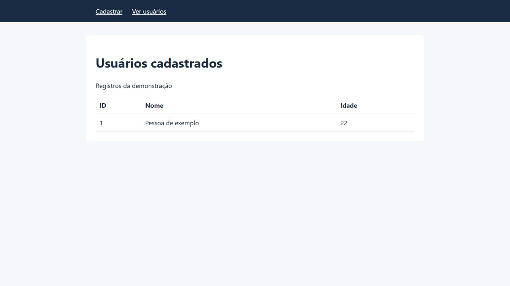

# Cadastro de usuários com Django

Aplicação de estudo em Python e Django para cadastrar e listar usuários com nome e idade. O projeto evolui uma implementação inicial com validação de formulário, separação entre consultas e gravações e testes de comportamento.

## Funcionalidades

- Cadastro com nome obrigatório, remoção de espaços nas extremidades e limite de 255 caracteres.
- Validação de idade inteira e não negativa, com erros exibidos no formulário.
- Listagem ordenada por ID e mensagem para lista vazia.
- Redirecionamento após o cadastro, evitando repetir o envio ao atualizar a listagem.
- Proteção CSRF e escape de HTML na exibição dos nomes.
- Interface em português, com estilos locais e sem dependência de CDN.



## Tecnologias

- Python 3.14
- Django 5.2.18
- SQLite
- HTML e CSS

## Executar no Windows

Na pasta do projeto, execute pelo PowerShell:

```powershell
py -m venv .venv
py -m pip --python .venv\Scripts\python.exe install -r requirements.txt
.\.venv\Scripts\python.exe manage.py migrate
.\.venv\Scripts\python.exe manage.py runserver 127.0.0.1:8765
```

Abra [http://127.0.0.1:8765/](http://127.0.0.1:8765/). Para encerrar o servidor, pressione `Ctrl+C` no terminal.

O banco SQLite é criado localmente pelas migrações e não acompanha o projeto. Utilize somente nomes e idades fictícios na demonstração.

## Rotas e fluxo

| Método e rota | Comportamento |
|---|---|
| `GET /` | Exibe o formulário vazio. |
| `GET /usuarios/` | Consulta e exibe os registros. |
| `POST /usuarios/` válido | Valida os campos, salva e redireciona para a listagem. |
| `POST /usuarios/` inválido | Reexibe o formulário com os erros e status 400. |

Fluxo de cadastro: formulário HTML → view → validação pelo `UsuarioForm` → gravação pelo ORM → redirecionamento → consulta da listagem.

## Testes e verificações

```powershell
.\.venv\Scripts\python.exe manage.py test app_cad_usuarios --verbosity 2
.\.venv\Scripts\python.exe manage.py check
.\.venv\Scripts\python.exe manage.py makemigrations --check --dry-run
```

Os oito testes cobrem:

1. Consulta da listagem sem criar registros.
2. Cadastro válido, remoção de espaços do nome e atualização da listagem sem duplicar o cadastro.
3. Rejeição de nomes vazios ou acima do limite de caracteres.
4. Rejeição de idades ausentes, negativas, não inteiras ou fora do intervalo aceito.
5. Rejeição de campos obrigatórios ausentes.
6. Escape de HTML na exibição dos nomes.
7. Rejeição de POST sem token CSRF, com a proteção ativada no cliente de teste.
8. Rejeição de método HTTP não suportado, sem alterar o banco.

Verificado em 20/10/2026 com Python 3.14 e Django 5.2.18: oito testes aprovados, verificações do Django sem problemas e nenhuma migração pendente. O fluxo de cadastro e listagem também foi conferido no navegador com dados fictícios.

## Organização

```text
app_cad_usuarios/
  forms.py          # Validação dos campos do formulário
  models.py         # Modelo Usuario: ID, nome e idade
  views.py          # Consulta, cadastro e redirecionamento
  tests.py          # Testes de comportamento e regressão
  migrations/       # Criação do modelo e renomeação inicial
  templates/usuarios/
    base.html
    home.html
    usuarios.html
projeto_cad_usuarios/
  settings.py       # Configuração para demonstração local
  urls.py
  asgi.py
  wsgi.py
docs/
  demonstracao.png
manage.py
requirements.txt
```

## Escopo e limitações

A aplicação implementa criação e leitura de registros. Edição, exclusão, autenticação e controle de acesso não foram implementados. Nomes repetidos são permitidos.

As regras de nome e idade estão no formulário. Gravações diretas pelo ORM precisam de validação própria. O redirecionamento evita novo envio ao atualizar a listagem; dois POSTs independentes ainda podem criar registros distintos.

A configuração é destinada ao uso local: `DEBUG=True`, chave de demonstração e hosts restritos a `localhost` e `127.0.0.1`. O servidor de desenvolvimento não é uma configuração de produção. Uma implantação pública exige configuração própria de segredo, hosts, HTTPS e acesso aos dados. A variável `DJANGO_SECRET_KEY` pode substituir a chave de demonstração, mas essa mudança isolada não prepara a aplicação para produção.

## Referências

- [Django: ModelForm e validação](https://docs.djangoproject.com/en/5.2/topics/forms/modelforms/)
- [Django: formulários, GET e POST](https://docs.djangoproject.com/en/5.2/topics/forms/)
- [Django: testes](https://docs.djangoproject.com/en/5.2/topics/testing/overview/)
- [Django: checklist de implantação](https://docs.djangoproject.com/en/5.2/howto/deployment/checklist/)

Parte da revisão de validação, fluxo de requisições, testes e documentação contou com assistência de IA.
